# packet-hunt-wireshark-soc
Wireshark SOC lab journal: detecting SYN scans, FTP brute force, cleartext credentials and VoIP traffic through packet analysis

# 🔍 Packet Hunt: Wireshark Lab Journal

**Hands-on packet analysis for SOC analysts: spotting scans, brute force, cleartext leaks and VoIP eavesdropping in captured traffic.**


---

## 📌 Project Overview

This repository documents six hands-on packet-analysis labs completed with Wireshark in a sandboxed cybersecurity lab. Each lab hides a small "incident" inside captured traffic. The goal is to find the evidence, explain what happened, and recommend how a defender would stop it.

> ⚠️ **Educational use only.** All traffic was captured inside an isolated training lab. Never capture or analyze traffic on networks you don't own or have written permission to test.

---

## 🎯 Objectives

- Capture and inspect live network traffic with Wireshark.
- Build precise display filters to isolate suspicious activity.
- Detect SYN port scanning and FTP brute-force behavior.
- Reconstruct conversations using Follow TCP Stream.
- Find hidden data and exposed credentials in HTTP traffic.
- Analyze SIP and RTP traffic and replay a captured VoIP call.
- Understand why encryption matters for every protocol tested.

---

## ⚙️ Lab Configuration

| Component | Configuration |
|---|---|
| Lab platform | Cloud-based cybersecurity lab |
| Host OS | Windows 10 |
| Analysis tool | Wireshark |
| Protocols | TCP, FTP, HTTP, SIP, RTP |
| Number of labs | 6 |
| Focus | Network security monitoring |

---

# 🪜 Lab Execution Procedure

## Step 1. Access the Lab Environment

Opened the Wireshark SOC lab, which provides a Windows 11 desktop with Wireshark pre-installed for packet capture and analysis.

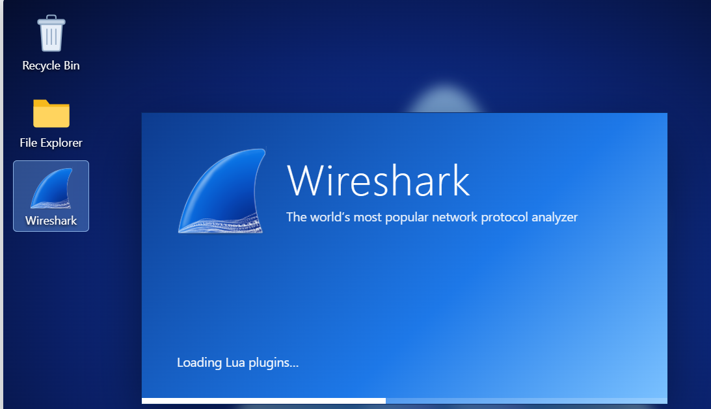

---

## Step 2. Start Packet Capture

Launched Wireshark, selected the active network interface, and started capturing traffic.

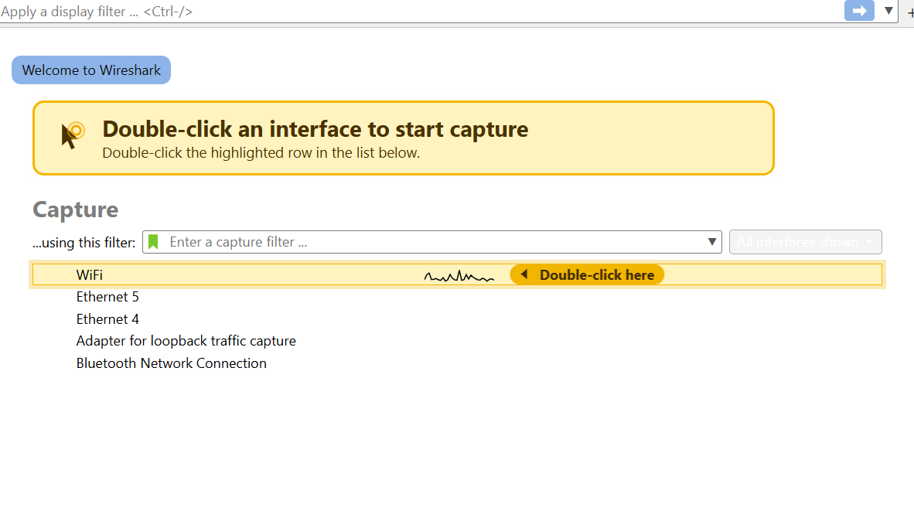

---

## Step 3. Detect a SYN Port Scan

Applied this display filter to show only connection attempts:

```
tcp.flags.syn == 1 
```

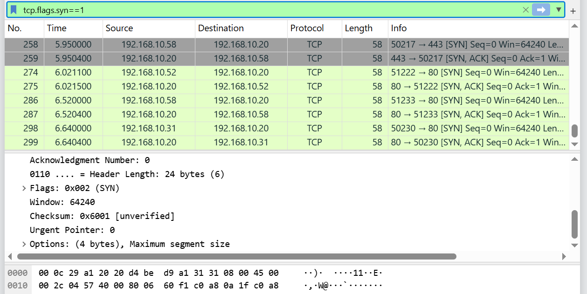


**Findings:**
- One host sent SYN packets to many different ports, which is typical scanner behavior.
- SYN/ACK replies revealed open ports; RST replies revealed closed ports.
- Attack type: half-open (SYN) port scan.

**Recommendation:** Alert on one source touching many ports in a short time, and block it at the firewall.

---

## Step 4. Investigate FTP Brute-Force Attempts

Filtered FTP traffic and then narrowed to failed and successful logins:

```
ftp
```
```
ftp.response.code == 530
```
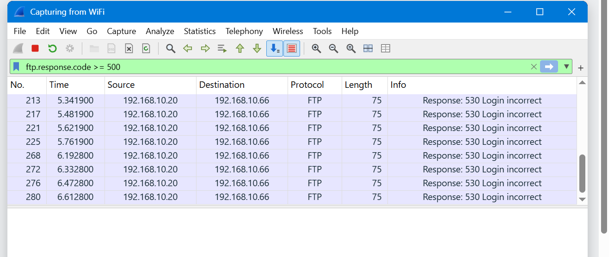

```
ftp.response.code == 230
```

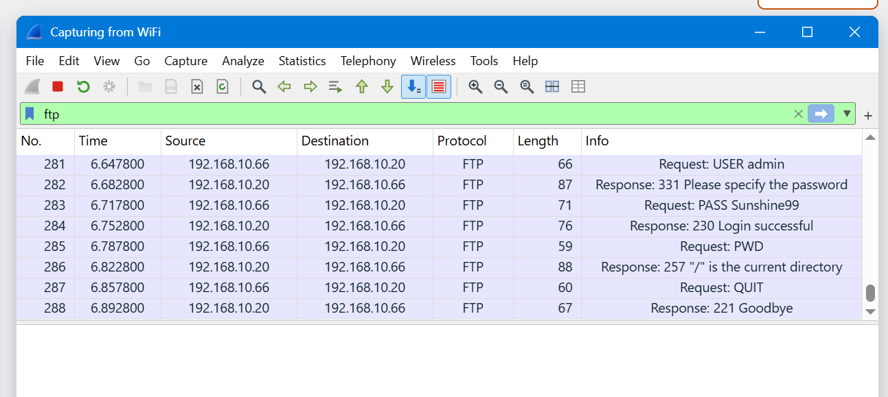

Used Follow → TCP Stream to read the credential that finally worked.

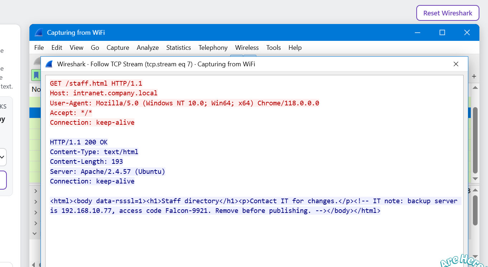

**Findings:**
- A long run of `530` (login incorrect) responses came from one source.
- A `230` (login successful) followed the failures.
- FTP sent the username and password in cleartext.

**Recommendation:** Use SFTP/FTPS, enforce account lockouts, and require strong authentication.

---

## Step 5. Analyze a Cleartext TCP Conversation

Opened **Statistics → Conversations** to find an unusual busy port, then filtered on it:

```
tcp.port == 5000
```

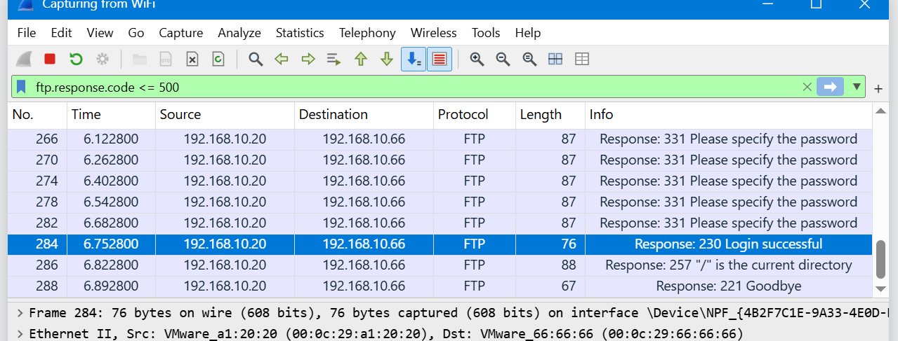

Used Follow → TCP Stream to rebuild the chat between client and server.

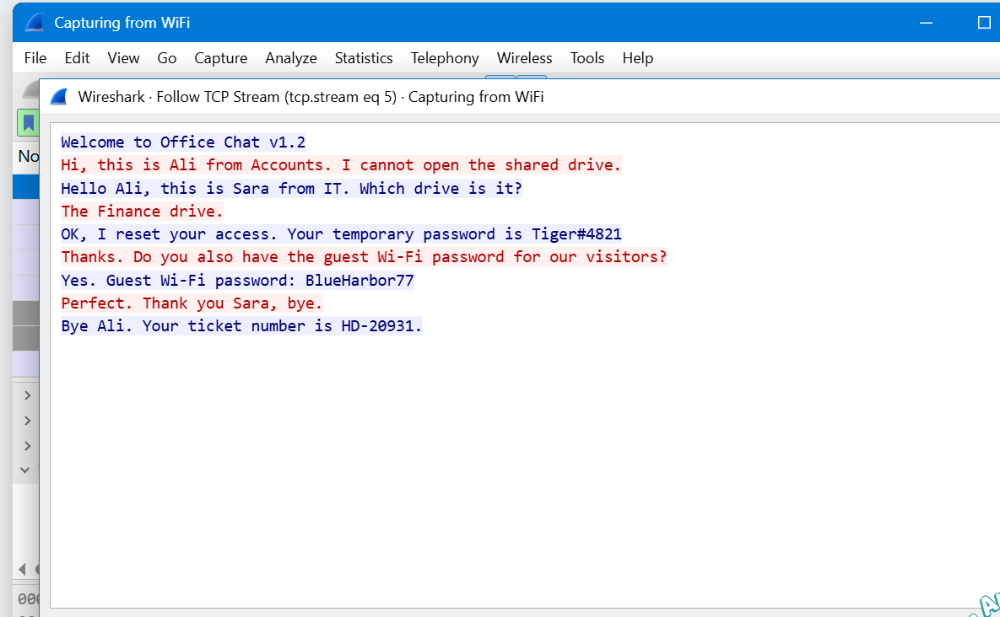

**Findings:**
- Identified the client and server in the conversation.
- Read the full chat in plain text.
- Sensitive content travelled with no encryption.

**Recommendation:** Wrap custom protocols in TLS.

---

## Step 6. Find Hidden Information in HTTP Traffic

Filtered web traffic and reviewed requested pages:

```
http
```

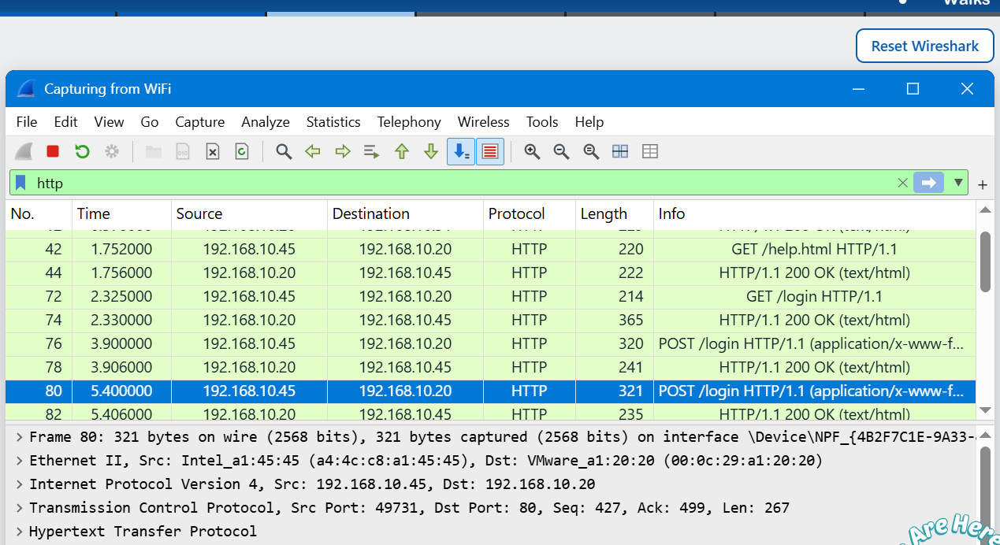

Followed the suspicious stream and also checked **File → Export Objects → HTTP**.

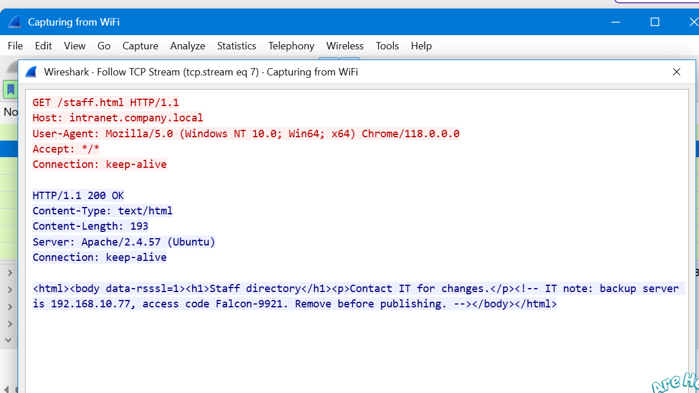

**Findings:**
- A page contained an HTML comment never meant for visitors.
- The server answered with `200 OK`.
- A downloadable text file was exposed.

**Recommendation:** Remove developer comments from production pages and restrict internal documents.

---

## Step 7. Examine Credentials in HTTP POST Requests

Isolated login submissions:

```
http.request.method == "POST"
```

Expanded **HTML Form URL Encoded** in the packet details to see the submitted fields.

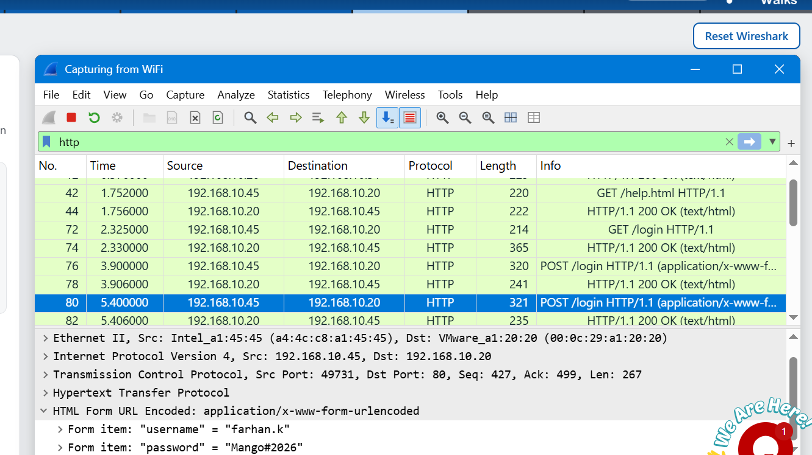

**Findings:**
- The `/login` endpoint received form data over plain HTTP.
- Username and password were readable in the packet.
- Multiple login attempts were visible.

**Recommendation:** Serve all login pages over HTTPS and enable HSTS.

> 🔒 Credentials in the screenshots are lab-only and have been redacted where needed.

---

## Step 8. Analyze VoIP Traffic (SIP and RTP)

Reviewed call setup first:

```
sip
```

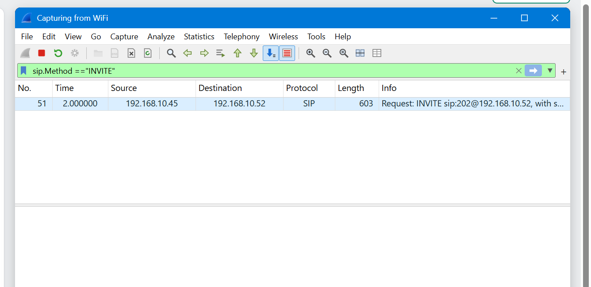

Then the voice stream:

```
rtp
```

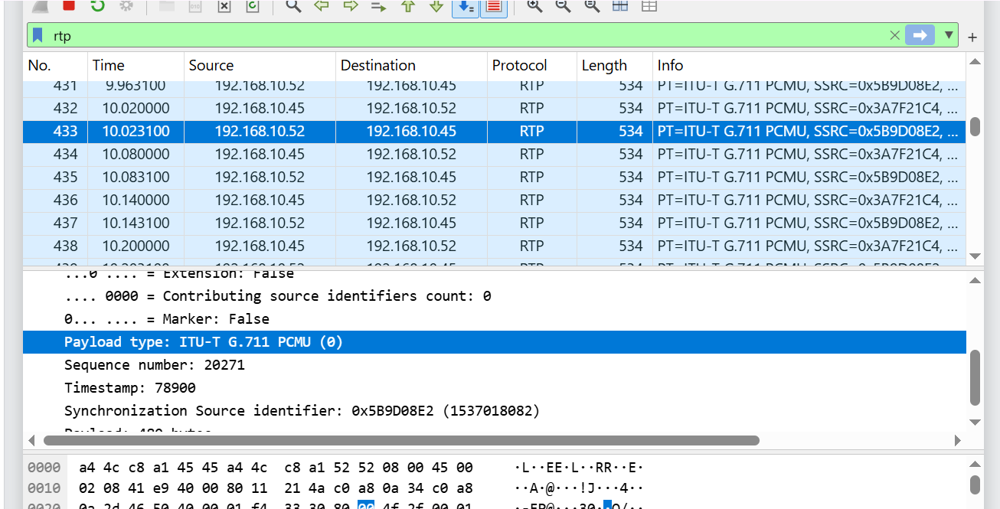

Opened **Telephony → VoIP Calls** and replayed the captured audio.

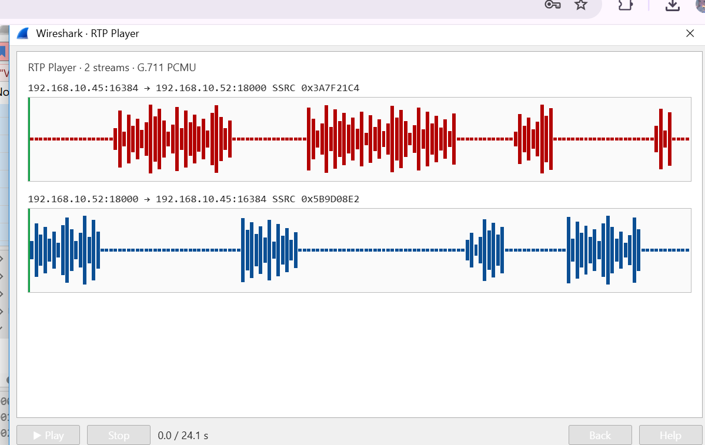

**Findings:**
- SIP handled call setup; RTP carried the voice.
- The call used the G.711 PCMU codec.
- The audio could be replayed because it was not encrypted.

**Recommendation:** Use TLS for SIP and SRTP for voice media.

---

# 🔎 Lab Verification

| Test | Wireshark Filter / Action | Expected Result |
|---|---|---|
| Packet capture | Active interface | Packets captured |
| SYN scan | `tcp.flags.syn == 1 ` | Scanner identified |
| FTP brute force | `ftp.response.code == 530` | Repeated failed logins |
| TCP conversation | `tcp.port == 5000` | Chat reconstructed |
| HTTP investigation | `http` | Hidden data found |
| Credential exposure | `http.request.method == "POST"` | Login fields visible |
| VoIP signaling | `sip` | Call setup identified |
| VoIP media | `rtp` | Audio stream replayed |

---

# 🧬 MITRE ATT&CK Mapping

| Step | Behavior | Technique |
|---|---|---|
| 3 | SYN scan | T1046: Network Service Discovery |
| 4 | FTP brute force | T1110: Brute Force |
| 5, 6, 8 | Reading cleartext sessions and calls | T1040: Network Sniffing |
| 7 | Credentials exposed over HTTP | T1040 / T1552: Unsecured Credentials |

---

# 🐞 Problems Encountered and Solutions

**Problem 1. Too many packets to read**
- Issue: The capture held many protocols, which made relevant traffic hard to find.
- Solution: Used display filters and **Protocol Hierarchy** to narrow it down.

**Problem 2. Single packets didn't show the full story**
- Issue: Individual TCP packets don't show the whole conversation.
- Solution: Used **Follow → TCP Stream** to rebuild it.

**Problem 3. Identifying the protocol on a custom port**
- Issue: Port 5000 is not tied to a standard protocol.
- Solution: Used **Statistics → Conversations** and inspected stream contents.

**Problem 4. Cleartext data everywhere**
- Issue: Credentials and messages were visible in several protocols.
- Solution: Documented the exposure and recommended HTTPS, SFTP, TLS and SRTP.

---

# 💡 What I Learned

- **Packet capture and analysis:** how to capture traffic and read packet details.
- **Display filters:** how to isolate exactly the traffic that matters.
- **Attack recognition:** how port scans and brute-force attempts look on the wire.
- **Stream reconstruction:** how to rebuild whole conversations from packets.
- **Security weaknesses:** how cleartext protocols expose data to anyone on the network.
- **SOC thinking:** every finding should end with evidence and a defensive recommendation.

---

# 🔐 Security and Ethical Use

All exercises were performed in a controlled educational lab. This repository is for learning purposes only.

---

# 🔗 Tools and Resources

- Wireshark: https://www.wireshark.org
- Display Filter Reference: https://www.wireshark.org/docs/dfref/

---

## Author Details

| Field | Details |
|-------|---------|
| Student name | Syeda Sarooj Kareem |
| Batch ID | [B084] |
| Training program | [Cybersecurity Internship] |
| Assignment | WK1-PM1 - Wireshark SOC Lab |
| Repository | https://github.com/Sarooj-kareem/packet-hunt-wireshark-soc |
| Completion date | 06-11-2026 |
|LinkedIn   | https://lnkd.in/p/dv6tQZPR|

---

